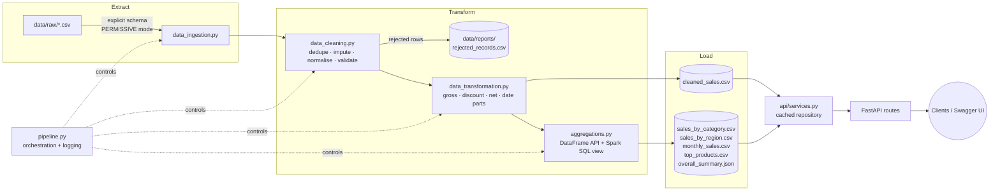

# Sales Data Processing Pipeline

An end-to-end **ETL pipeline** built with **PySpark** and **Spark SQL**. It ingests messy raw sales
transactions from CSV, cleans and validates them, derives revenue metrics, builds analytical
aggregations, and serves the results through a **FastAPI** REST API.

---

## Table of contents

1. [Problem statement](#problem-statement)
2. [Objectives](#objectives)
3. [Technology stack](#technology-stack)
4. [Architecture](#architecture)
5. [Project structure](#project-structure)
6. [Dataset](#dataset)
7. [ETL workflow](#etl-workflow)
8. [Data cleaning](#data-cleaning)
9. [Transformation logic](#transformation-logic)
10. [Spark SQL examples](#spark-sql-examples)
11. [API endpoints](#api-endpoints)
12. [Installation](#installation)
13. [Running the project](#running-the-project)
14. [Example API requests](#example-api-requests)
15. [Testing](#testing)
16. [Configuration](#configuration)
17. [Troubleshooting](#troubleshooting)
18. [Future enhancements](#future-enhancements)

---

## Problem statement

Sales teams export transaction data from several systems. The exports are inconsistent: some records are
duplicated, some have missing customer or product fields, quantities and prices are sometimes invalid,
dates come in mixed or impossible formats, and category and region values are written with inconsistent
casing. Analysts can't trust reports built directly on this data.

This project turns the raw exports into a **clean, validated, analytics-ready dataset** and a set of
**business KPIs**, and serves them through an API that dashboards and other services can call.

## Objectives

- Read raw CSV data with an **explicit schema** and detect malformed records.
- Apply **auditable data cleaning**, where every step logs how many records it changed and rejected rows are
  kept with a reason.
- Derive **monetary and calendar columns** using native PySpark functions.
- Build aggregations with the **DataFrame API** and **Spark SQL**.
- Persist processed outputs (CSV + JSON) and a run report.
- Serve results through a documented **FastAPI** service that never starts a Spark job per request.
- Cover the logic with fast **pytest** unit tests.

## Technology stack

| Layer | Technology |
|-------|------------|
| Processing engine | Apache Spark 4.x via **PySpark** (DataFrame API + **Spark SQL**) |
| Language | **Python 3.10+** (tested on Python 3.14, Windows 11) |
| Runtime | **Java 17 or 21** (required by Spark 4) |
| API | **FastAPI**, **Pydantic v2**, **Uvicorn** |
| API data access | **pandas** (only to read the small processed files) |
| Configuration | **python-dotenv** |
| Testing | **pytest**, **httpx** / FastAPI `TestClient` |

## Architecture



The pipeline and the API are **decoupled**. Spark runs only during the batch ETL job, and the API reads the
processed files. The API caches each file in memory and reloads it when the file's modification time
changes.

## Project structure

```text
sales-data-pipeline/
├── data/
│   ├── raw/                    # raw input CSV (generated)
│   ├── processed/              # pipeline outputs consumed by the API
│   └── reports/                # pipeline_report.json, rejected_records.csv
├── src/
│   ├── config.py               # centralised settings from env / .env
│   ├── logging_config.py       # structured logging (console + logs/pipeline.log)
│   ├── exceptions.py           # domain-specific errors with clear messages
│   ├── schemas.py              # Spark schema + domain constants
│   ├── spark_session.py        # SparkSession factory, Java checks, safe shutdown
│   ├── data_ingestion.py       # Extract: read + validate CSV
│   ├── data_cleaning.py        # Transform: data quality rules
│   ├── data_transformation.py  # Transform: derived columns + monetary validation
│   ├── aggregations.py         # DataFrame + Spark SQL analytics
│   ├── data_output.py          # Load: CSV / JSON writers
│   ├── pipeline.py             # orchestration of all ETL steps
│   └── api/
│       ├── main.py             # FastAPI app factory + exception handlers
│       ├── routes.py           # HTTP endpoints (thin)
│       ├── schemas.py          # Pydantic response models
│       ├── services.py         # data-access layer (cached file repository)
│       └── dependencies.py     # dependency injection providers
├── scripts/
│   ├── generate_sample_data.py # reproducible messy dataset generator
│   └── run_pipeline.py         # CLI entry point for the ETL job
├── tests/                      # pytest suite (small in-memory datasets)
├── logs/                       # pipeline.log, api.log
├── main.py                     # unified CLI: generate | pipeline | api
├── requirements.txt
├── pytest.ini
├── .env.example
└── .gitignore
```

## Dataset

`scripts/generate_sample_data.py` creates a reproducible dataset using a fixed random seed (default `42`).
The same seed always produces the same file. With the defaults it writes about **1,100 order lines**:
700 orders with 1–3 products each, plus duplicates and malformed lines.

| Column | Type | Description |
|--------|------|-------------|
| `order_id` | string | Order identifier (`ORD-000123`); an order can contain several product lines |
| `order_date` | string → date | Order date (mostly `yyyy-MM-dd`, some `yyyy/MM/dd` and `dd-MM-yyyy`) |
| `customer_id` | string | Customer identifier (`CUST-0042`) |
| `product_id` | string | Product identifier (`P1001`) |
| `product_name` | string | Product name |
| `category` | string | Electronics, Furniture, Clothing, Accessories |
| `region` | string | North, South, East, West |
| `quantity` | int | Units sold |
| `unit_price` | double | Price per unit |
| `discount` | double | Discount rate (fraction, e.g. `0.15`) |
| `payment_method` | string | Credit Card, Debit Card, UPI, Net Banking, Cash, PayPal |

**Data quality issues injected on purpose:** exact duplicates, business-key duplicates, missing customer IDs
(`""`, `NULL`, `N/A`), missing product names and categories, negative/zero/non-numeric quantities,
negative/zero/blank/non-numeric prices, inconsistent casing and whitespace (`ELECTRONICS`, `  north `),
invalid dates (`2024-13-45`, `2025-02-30`, `not_a_date`), percentage-style or invalid discounts (`15`,
`-0.1`, `1.5`), and structurally malformed lines with the wrong number of columns.

## ETL workflow

`src/pipeline.py` runs these steps and returns a `PipelineResult` with `SUCCESS` or `FAILED`:

1. **Initialise Spark.** `local[*]` by default. Java is checked first and you get a clear error if it is missing.
2. **Load raw CSV.** Explicit schema, header handling, `PERMISSIVE` mode with a `_corrupt_record` column.
3. **Validate input.** Missing file, empty file, missing required columns, and inconsistent headers raise meaningful errors.
4. **Clean data.** See [Data cleaning](#data-cleaning).
5. **Transform data.** Monetary and date columns, plus validation.
6. **Aggregate.** Category, region, monthly, top 10 products, overall summary.
7. **Save outputs.** Written to `data/processed/` and `data/reports/`. Directories are created automatically.
8. **Log statistics.** Written to the console, `logs/pipeline.log`, and `data/reports/pipeline_report.json`.
9. **Stop Spark.** Runs in a `finally` block, so Spark stops even when a step fails.

**Outputs**

| File | Contents |
|------|----------|
| `data/processed/cleaned_sales.csv` | Cleaned and transformed transactions |
| `data/processed/sales_by_category.csv` | Revenue, quantity, orders, AOV per category |
| `data/processed/sales_by_region.csv` | Revenue, orders, AOV per region |
| `data/processed/monthly_sales.csv` | Revenue and orders per year/month |
| `data/processed/top_products.csv` | Top 10 products by revenue |
| `data/processed/overall_summary.json` | Overall KPIs |
| `data/reports/rejected_records.csv` | Rows that could not be processed, with `rejection_reason` |
| `data/reports/pipeline_report.json` | Run status, duration, per-step record counts, output paths |

## Data cleaning

Every rule logs how many records it affected. Records are only removed when they can't be processed
reliably, and those are written to `rejected_records.csv` with a reason instead of being silently dropped.

| # | Rule | Technique |
|---|------|-----------|
| 1 | Placeholder values | Trim strings; `""`, `NULL`, `N/A`, `none`, `nan`, `-` → `null` |
| 2 | Casing | `initcap(lower(trim(x)))` for category and region; unknown regions → `Unknown` |
| 3 | Dates | `try_to_timestamp` with several accepted formats → `DateType`; impossible dates → `null` |
| 4 | Exact duplicates | `dropDuplicates()` over all business columns |
| 5 | Business-key duplicates | One row per `(order_id, product_id)`, keeping the **most complete** row (window + `row_number`) |
| 6 | Missing product name / category | Imputed from the most frequent value for the same `product_id`; otherwise `Unknown Product` / `Uncategorized` |
| 7 | Missing customer ID | Replaced with `GUEST`, so the revenue is kept. Guests are excluded from customer counts |
| 8 | Invalid unit price (≤0, null, non-numeric) | Imputed with the product's **median** valid price; rejected if no reference exists |
| 9 | Invalid quantity (≤0, null, non-numeric) | **Rejected**, because revenue can't be inferred reliably |
| 10 | Missing order/product ID, invalid date | **Rejected** |

Each run logs the record count before cleaning, after cleaning, and rejected, so every input row is
accounted for:
`records_before = records_after + records_rejected + duplicates_removed`.

## Transformation logic

| Column | Formula |
|--------|---------|
| `discount` | Validated: `null → 0`, `15 → 0.15` (percentage notation), outside `[0, 0.9] → 0` |
| `gross_amount` | `round(quantity * unit_price, 2)` |
| `discount_amount` | `round(gross_amount * discount, 2)` |
| `net_sales` | `round(gross_amount - discount_amount, 2)` |
| `order_year` / `order_month` / `order_quarter` | `year()`, `month()`, `quarter()` of `order_date` |

After the transformation, `validate_sales_metrics` checks that `gross_amount > 0`, `0 ≤ net_sales ≤
gross_amount`, the discount is within range, and `gross_amount - discount_amount = net_sales`. If any row
fails, the job stops with a `DataValidationError`.

All processing uses native PySpark column functions. The pipeline never converts the dataset to pandas.

> **Revenue** in all reports means `net_sales` (after discounts).
> **Average order value (AOV)** = revenue / number of distinct orders.

## Spark SQL examples

The transformed dataset is registered as a temporary view named `sales`.

```sql
-- Sales by region
SELECT region,
       ROUND(SUM(net_sales), 2)                            AS total_revenue,
       COUNT(DISTINCT order_id)                            AS total_orders,
       ROUND(SUM(net_sales) / COUNT(DISTINCT order_id), 2) AS average_order_value
FROM sales
GROUP BY region
ORDER BY total_revenue DESC;

-- Monthly sales
SELECT order_year AS year, order_month AS month,
       ROUND(SUM(net_sales), 2) AS total_revenue,
       COUNT(DISTINCT order_id) AS total_orders
FROM sales
GROUP BY order_year, order_month
ORDER BY year, month;

-- Overall summary (guest customers excluded from the customer count)
SELECT ROUND(SUM(net_sales), 2) AS total_revenue,
       COUNT(DISTINCT order_id) AS total_orders,
       COUNT(DISTINCT CASE WHEN customer_id <> 'GUEST' THEN customer_id END) AS total_customers,
       COUNT(DISTINCT product_id) AS total_products,
       ROUND(TRY_DIVIDE(SUM(net_sales), COUNT(DISTINCT order_id)), 2) AS average_order_value
FROM sales;
```

Sales by category and top products use the DataFrame API (`groupBy().agg(...)`), so the project shows both
styles.

## API endpoints

| Method | Path | Description |
|--------|------|-------------|
| GET | `/` | Welcome message, version, list of endpoints |
| GET | `/health` | `ok`, or `degraded` if processed files are missing |
| GET | `/sales/summary` | Overall KPIs |
| GET | `/sales/category` | Category-wise sales |
| GET | `/sales/region` | Region-wise sales |
| GET | `/sales/monthly` | Monthly sales |
| GET | `/sales/top-products` | Top 10 products by revenue |
| GET | `/sales/transactions` | Cleaned transactions. Query: `limit` (1–500, default 50), `offset` (≥0), `category`, `region` (case-insensitive) |

**Status codes:** `200` success; `422` invalid query parameters; `503` processed data not generated yet
(the message tells you to run the pipeline); `500` unexpected error (logged to `logs/api.log`).

Interactive docs: **Swagger UI** at <http://127.0.0.1:8000/docs>, ReDoc at <http://127.0.0.1:8000/redoc>.

## Installation

### 1. Prerequisites

- **Python 3.10+** (tested with Python 3.14 on Windows 11).
- **Java 17 or 21 (required by PySpark 4.x).** Spark runs on the JVM, so `pip install pyspark` is not
  enough on its own.

#### Installing Java on Windows 11

```powershell
# Option A - winget (installs system-wide and sets JAVA_HOME)
winget install EclipseAdoptium.Temurin.21.JDK

# Verify (open a NEW terminal afterwards)
java -version
echo $env:JAVA_HOME
```

Option B: download a JDK 21 `.zip` from <https://adoptium.net>, extract it anywhere, and point the
project's `.env` file at it (no admin rights needed):

```dotenv
JAVA_HOME=C:\Users\<you>\.jdks\jdk-21.0.x+y
```

The project loads `.env` before starting Spark. If Java isn't found, you get a clear error with these
instructions.

> **Windows and Hadoop `winutils.exe`.** Spark's native file writer needs Hadoop's `winutils.exe` on
> Windows. You don't have to install it: with `OUTPUT_WRITE_MODE=auto` (the default), the pipeline uses
> Spark's distributed writer when `HADOOP_HOME\bin\winutils.exe` exists. Otherwise it streams results
> partition by partition with `toLocalIterator()`, so the full dataset is never collected into driver
> memory. On Linux and macOS the native Spark writer is always used.

### 2. Create a virtual environment and install dependencies

```powershell
cd sales-data-pipeline
python -m venv .venv
.venv\Scripts\activate          # Linux/macOS: source .venv/bin/activate
pip install -r requirements.txt
copy .env.example .env          # optional; Linux/macOS: cp .env.example .env
```

## Running the project

```powershell
# C. Generate sample data  ->  data/raw/sales_data.csv
python scripts/generate_sample_data.py
#    options: --orders 700 --customers 250 --seed 42 --output data/raw/sales_data.csv

# D. Run the ETL pipeline  ->  data/processed/*, data/reports/*, logs/pipeline.log
python scripts/run_pipeline.py
#    options: --input <csv file or directory> --output <directory>

# E. Start the API
uvicorn src.api.main:app --reload

# F. Open Swagger UI
#    http://127.0.0.1:8000/docs

# G. Run tests
pytest -v
```

`main.py` provides the same commands through one entry point:
`python main.py generate | pipeline | api [--reload]`.

`run_pipeline.py` exits with code `0` on success and `1` on failure, so it can be used in schedulers and CI.

## Example API requests

The responses below are real output from the default sample dataset (`--seed 42`).

```powershell
curl http://127.0.0.1:8000/sales/summary
```

```json
{
  "total_revenue": 231769.05,
  "total_gross_sales": 257124.98,
  "total_discount": 25355.93,
  "total_quantity": 2756,
  "total_orders": 679,
  "total_customers": 237,
  "total_products": 24,
  "average_order_value": 341.34,
  "first_order_date": "2024-01-01",
  "last_order_date": "2025-06-30",
  "generated_at": "2026-11-21T15:27:46.069188Z"
}
```

```powershell
curl http://127.0.0.1:8000/sales/category
```

```json
[
  {"category": "Electronics", "total_revenue": 78153.01, "total_quantity": 853, "total_orders": 264, "average_order_value": 296.03},
  {"category": "Furniture",   "total_revenue": 77660.42, "total_quantity": 520, "total_orders": 183, "average_order_value": 424.37},
  {"category": "Clothing",    "total_revenue": 41085.66, "total_quantity": 742, "total_orders": 233, "average_order_value": 176.33},
  {"category": "Accessories", "total_revenue": 34869.96, "total_quantity": 641, "total_orders": 217, "average_order_value": 160.69}
]
```

```powershell
curl http://127.0.0.1:8000/sales/region
```

```json
[
  {"region": "South", "total_revenue": 68202.91, "total_orders": 195, "average_order_value": 349.76},
  {"region": "North", "total_revenue": 63843.62, "total_orders": 188, "average_order_value": 339.59},
  {"region": "East",  "total_revenue": 63315.71, "total_orders": 190, "average_order_value": 333.24},
  {"region": "West",  "total_revenue": 36406.81, "total_orders": 106, "average_order_value": 343.46}
]
```

```powershell
curl "http://127.0.0.1:8000/sales/transactions?limit=1&offset=0&category=electronics&region=north"
```

```json
{
  "total": 85,
  "limit": 1,
  "offset": 0,
  "count": 1,
  "items": [
    {
      "order_id": "ORD-000125", "order_date": "2024-01-06", "customer_id": "CUST-0232",
      "product_id": "P1005", "product_name": "USB-C Hub", "category": "Electronics", "region": "North",
      "quantity": 2, "unit_price": 40.14, "discount": 0.0, "payment_method": "UPI",
      "gross_amount": 80.28, "discount_amount": 0.0, "net_sales": 80.28,
      "order_year": 2024, "order_month": 1, "order_quarter": 1
    }
  ]
}
```

Error responses:

```json
// GET /sales/summary before the pipeline has run -> HTTP 503
{"detail": "Processed data file 'overall_summary.json' was not found. Run the ETL pipeline first: python scripts/run_pipeline.py"}

// GET /sales/transactions?limit=0 -> HTTP 422 (FastAPI validation error)
```

### Pipeline run statistics (sample dataset)

| Metric | Records |
|--------|--------:|
| Raw input rows | 1,060 |
| Malformed rows flagged | 16 |
| Category/region casing normalised | 207 |
| Exact duplicates removed | 25 |
| Business-key duplicates removed | 10 |
| Missing product names filled | 26 |
| Missing categories filled | 35 |
| Missing customer IDs → `GUEST` | 47 |
| Invalid prices imputed (product median) | 25 |
| Discounts fixed (missing / percentage / invalid) | 5 / 8 / 2 |
| **Rejected**: invalid order date | 19 |
| **Rejected**: invalid quantity | 31 |
| **Cleaned output rows** | **975** |

1,060 = 975 cleaned + 50 rejected + 35 duplicates.

## Testing

```powershell
pytest -v
```

The tests use **small in-memory datasets** and a shared `local[1]` SparkSession. They don't depend on the
generated sample data or on running the full pipeline.

| File | Covers |
|------|--------|
| `tests/test_ingestion.py` | Explicit schema, malformed rows, missing file/columns, header order |
| `tests/test_cleaning.py` | Null placeholders, casing, dates, exact and business-key duplicates, imputation, rejection reasons, record-count reconciliation |
| `tests/test_transformations.py` | Revenue calculations, discount validation, date parts, monetary validation, CSV writer |
| `tests/test_aggregations.py` | Category, region (SQL), monthly (SQL), top products, overall summary, cross-report consistency |
| `tests/test_api.py` | Every endpoint, pagination, filters, validation errors (422), missing data (503), OpenAPI docs |

If Java isn't available, the Spark tests are **skipped** with an explanation, and the API tests still run.

## Configuration

All settings are in `src/config.py` and read from environment variables or `.env`. Relative paths are
resolved against the project root, so nothing depends on machine-specific paths.

| Variable | Default | Description |
|----------|---------|-------------|
| `RAW_DATA_PATH` | `data/raw/sales_data.csv` | Raw CSV file **or** directory of CSV files |
| `PROCESSED_DATA_PATH` | `data/processed` | Output directory, also read by the API |
| `REPORTS_PATH` | `data/reports` | Run report and rejected records |
| `LOG_DIR` | `logs` | Log directory |
| `LOG_LEVEL` | `INFO` | Python log level |
| `SPARK_MASTER` | `local[*]` | Spark master URL |
| `SPARK_SHUFFLE_PARTITIONS` | `4` | Kept small for local data (Spark default is 200) |
| `SPARK_LOG_LEVEL` | `ERROR` | Spark's own log level |
| `OUTPUT_WRITE_MODE` | `auto` | `auto`, `spark` or `local` (see the winutils note above) |
| `JAVA_HOME` | system | Optional path to JDK 17/21 |

## Troubleshooting

| Symptom | Fix |
|---------|-----|
| `JavaNotFoundError: Java was not found…` | Install JDK 17/21 and set `JAVA_HOME` (system or `.env`) |
| `InputDataError: Input path not found` | Run `python scripts/generate_sample_data.py` |
| API returns `503` | Run `python scripts/run_pipeline.py` to generate the processed files |
| `ModuleNotFoundError: pyspark` | Activate the venv and run `pip install -r requirements.txt` |
| `HADOOP_HOME and hadoop.home.dir are unset` warning | Harmless on Windows. The pipeline uses the local streaming writer |
| `Python worker failed to connect back` | The project sets `PYSPARK_PYTHON` to the current interpreter. Make sure you run from the activated venv |

## Future enhancements

- Store processed data as **Parquet / Delta Lake**, partitioned by `order_year` / `order_month`.
- **Incremental loads** with watermarking instead of full reprocessing.
- Move the API's storage to a database (PostgreSQL / DuckDB) for large transaction tables.
- Data quality framework (Great Expectations / Deequ) with alerting thresholds.
- Orchestrate with **Airflow** or **Prefect**; containerise with Docker.
- Authentication, rate limiting and response caching on the API.
- Handle negative quantities as **returns** in a dedicated returns flow.
- CI pipeline (GitHub Actions) running lint and tests on every push.
